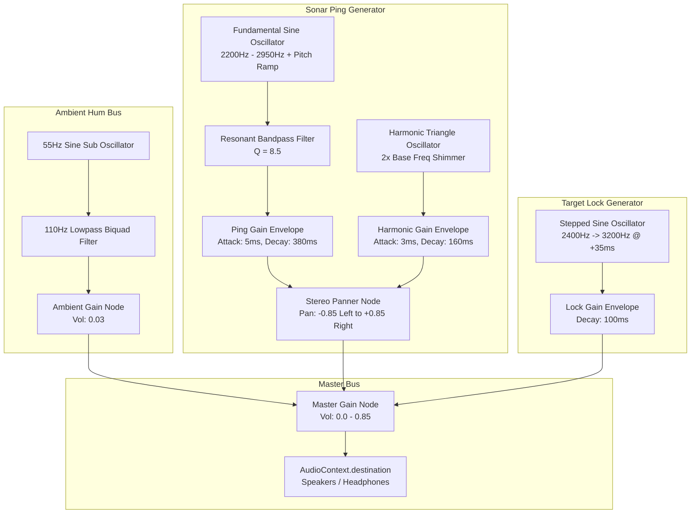

# Radar Audio Engine Architecture & Technology (`AUDIO.md`)

This document outlines the audio architecture, synthesis algorithms, and Web Audio API technology powering the **Radar Audio Engine** ([`RadarAudioEngine`](file:///Users/ernest.pascual/Downloads/Development/talks/talks/lib/bluetooth-radar/audio-engine.ts)) used in the **WRU?! Bluetooth Radar Experience** ([`/experience/find-your-officemate`](file:///Users/ernest.pascual/Downloads/Development/talks/talks/app/experience/find-your-officemate/page.tsx)).

---

## 1. Executive Summary & Design Philosophy

The `RadarAudioEngine` is a **100% generative, client-side Digital Signal Processing (DSP) synthesizer** built on the native browser [Web Audio API](https://developer.mozilla.org/en-US/docs/Web/API/Web_Audio_API).

### Why Generative Synthesis Instead of Audio Samples?
- **Zero Asset Overhead**: No external `.mp3`, `.wav`, or `.ogg` audio files to load, cache, or buffer over the network.
- **Zero Latency**: Sounds trigger instantaneously on the exact frame the radar sweep crosses a target.
- **Infinite Dynamic Variance**: Sonar frequency and stereo pan are dynamically parameterized in real-time based on physical distance ($0.2\text{m} - 5.0\text{m}$) and angle-of-arrival bearing ($0^\circ - 360^\circ$).
- **No Asset Licensing or Bandwidth Costs**: Procedurally calculated waveforms run entirely on client CPU hardware.

---

## 2. Web Audio DSP Signal Flow

The audio engine coordinates three main signal pathways into a unified master output bus:



---

## 3. Core Synthesizer Modules

### 3.1. Atmospheric Radar Sub-Hum (`startAmbientHum`)
To avoid an unnatural "dead silent" void before pings, the engine runs a continuous, low-frequency atmospheric sub-hum that replicates the mechanical baseline of classic CRT radar stations and submarine sonar rooms:

- **Oscillator**: Pure sine wave tuned to **$55\text{ Hz}$** ($A_1$ sub-bass note).
- **Filter**: 2nd-order lowpass `BiquadFilterNode` with a cutoff frequency of **$110\text{ Hz}$** to strip out upper harmonic noise.
- **Gain**: Subdued at **$0.03$ ($3\%$)** output level, providing subtle room ambience without interfering with voice or foreground audio.

```typescript
const osc = ctx.createOscillator();
osc.type = "sine";
osc.frequency.setValueAtTime(55, ctx.currentTime);

const filter = ctx.createBiquadFilter();
filter.type = "lowpass";
filter.frequency.setValueAtTime(110, ctx.currentTime);

const gain = ctx.createGain();
gain.gain.setValueAtTime(0.03, ctx.currentTime);
```

---

### 3.2. Crystal Retro Sonar Ping (`playSonarPing`)
The signature sound of the radar is a crisp, metallic sonar ping with distance-based pitch modulation and spatial panning.

#### A. Distance-to-Pitch Formula
Distance ($d \in [0.2\text{m}, 5.0\text{m}]$) is normalized and inversely mapped to high-frequency pitch. Targets closer to the radar produce higher-frequency, urgent crystal pings ($2950\text{ Hz}$), while distant targets sound deeper ($2200\text{ Hz}$):

$$\text{normDist} = \text{clamp}\left(\frac{\text{distance} - 0.2}{4.8}, 0, 1\right)$$

$$f_{\text{base}} = 2950 - (\text{normDist} \times 750) \quad [\text{Hz}]$$

#### B. Dynamic Pitch & Transient Modulation
To achieve a sharp acoustic "snap" and natural ring-down:
1. **$t = 0\text{ms}$**: Instant start at **$+8\%$ overshoot** ($f_{\text{base}} \times 1.08$) for transient attack clarity.
2. **$t = 25\text{ms}$**: Exponential ramp down to fundamental $f_{\text{base}}$.
3. **$t = 300\text{ms}$**: Subtle downward drift to **$-2\%$** ($f_{\text{base}} \times 0.98$) simulating Doppler dissipation.

#### C. Metallic Resonant Bandpass Filtering
A `BiquadFilterNode` with `bandpass` configuration and high resonance ($Q = 8.5$) isolates the center frequency, producing the iconic metallic ringing echo characteristic of naval sonar transducers.

#### D. Harmonic Overtone Shimmer
A secondary `triangle` wave oscillator runs at $2.0 \times f_{\text{base}}$, sliding down to $1.85 \times f_{\text{base}}$ over $80\text{ms}$. This harmonic overtone injects vintage cathode-ray tube shimmer into the sound.

#### E. Stereo Spatial Panning
Radar bearing ($\theta \in [0^\circ, 360^\circ]$) is translated into horizontal stereo panning:

$$\text{panX} = \sin\left(\frac{\theta \times \pi}{180}\right)$$

- **$0^\circ$ (North / Ahead)**: $\text{panX} = 0.0$ (Centered)
- **$90^\circ$ (East / Right)**: $\text{panX} = +0.85$ (Hard Right)
- **$180^\circ$ (South / Behind)**: $\text{panX} = 0.0$ (Centered)
- **$270^\circ$ (West / Left)**: $\text{panX} = -0.85$ (Hard Left)

#### F. Dual ADSR Gain Envelopes & Node Cleanup
- **Fundamental Gain**: $0.0001 \to 0.24$ in $5\text{ms}$ (linear attack) $\to 0.0001$ in $380\text{ms}$ (exponential decay).
- **Harmonic Gain**: $0.0001 \to 0.07$ in $3\text{ms}$ (linear attack) $\to 0.0001$ in $160\text{ms}$ (exponential decay).
- **Lifecycle Garbage Collection**: Nodes are explicitly stopped at $t + 0.42\text{s}$ and $t + 0.20\text{s}$ to prevent Web Audio memory leaks during continuous scanning.

---

### 3.3. Target Lock Double-Chirp (`playTargetLock`)
When a user clicks on a blip on the radar canvas or in the target inspector, `playTargetLock()` provides immediate tactile audio confirmation:

- **Oscillator**: Sine wave with instantaneous step pitch shifting.
- **Pitch Sequence**: $2400\text{ Hz}$ for $35\text{ms}$, stepping up to $3200\text{ Hz}$.
- **Decay**: $100\text{ms}$ exponential fade to silence ($0.15 \to 0.001$).

---

## 4. Browser Autoplay & AudioContext Lifecycle

Modern browsers (Chrome, Safari, Edge, Firefox) block audio playback until the user has performed an explicit gesture (click, tap, keyboard interaction).

`RadarAudioEngine` implements safe lazy initialization and resume handling:

```typescript
public init() {
  if (this.isInitialized && this.ctx) {
    if (this.ctx.state === "suspended") {
      this.ctx.resume().catch(() => {});
    }
    return;
  }
  // Initialize AudioContext & Master Gain upon first user click
}
```

### Integration Touchpoints in [`app/experience/find-your-officemate/page.tsx`](file:///Users/ernest.pascual/Downloads/Development/talks/talks/app/experience/find-your-officemate/page.tsx):
1. **Radar Sweep Ping Trigger**: In the 60fps canvas render loop, when the rotating sweep beam line intersects a detected target's polar coordinates, `radarAudio.playSonarPing(smoothedDistance, angle)` is called.
2. **Target Inspector Click**: Clicking any blip triggers `radarAudio.playTargetLock()`.
3. **Mute / Unmute Button**: The header volume control invokes `radarAudio.toggleMute()`, cleanly fading the master gain without throwing browser audio context errors.

---

## 5. API Reference (`RadarAudioEngine`)

| Method / Property | Signature | Description |
| :--- | :--- | :--- |
| `init()` | `(): void` | Initializes the `AudioContext` and ambient hum; safely resumes if suspended by browser autoplay policy. |
| `playSonarPing()` | `(distance?: number, angle?: number): void` | Synthesizes a spatial sonar ping with distance-based pitch ($2200-2950\text{Hz}$) and stereo panning ($-0.85$ to $+0.85$). |
| `playTargetLock()` | `(): void` | Synthesizes a crisp $2400\text{Hz} \to 3200\text{Hz}$ double-chirp when selecting or locking onto a device. |
| `setMuted()` | `(muted: boolean): void` | Sets the mute state and ramps master gain between `0.0` and `0.85`. |
| `toggleMute()` | `(): boolean` | Toggles mute state and returns the new boolean value. |
| `getMuted()` | `(): boolean` | Returns whether audio output is currently muted. |

---

## 6. Exported Singleton

The engine is exported as a pre-instantiated singleton for fast, unified access across all React components and hooks:

```typescript
import { radarAudio } from "@/lib/bluetooth-radar/audio-engine";

// Initialize on user interaction
radarAudio.init();

// Play sonar ping
radarAudio.playSonarPing(1.2, 45); // 1.2m away, 45° bearing

// Toggle mute state
const isMuted = radarAudio.toggleMute();
```
